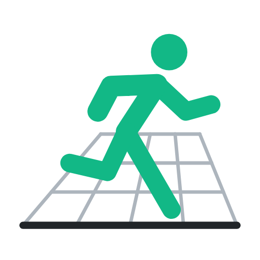
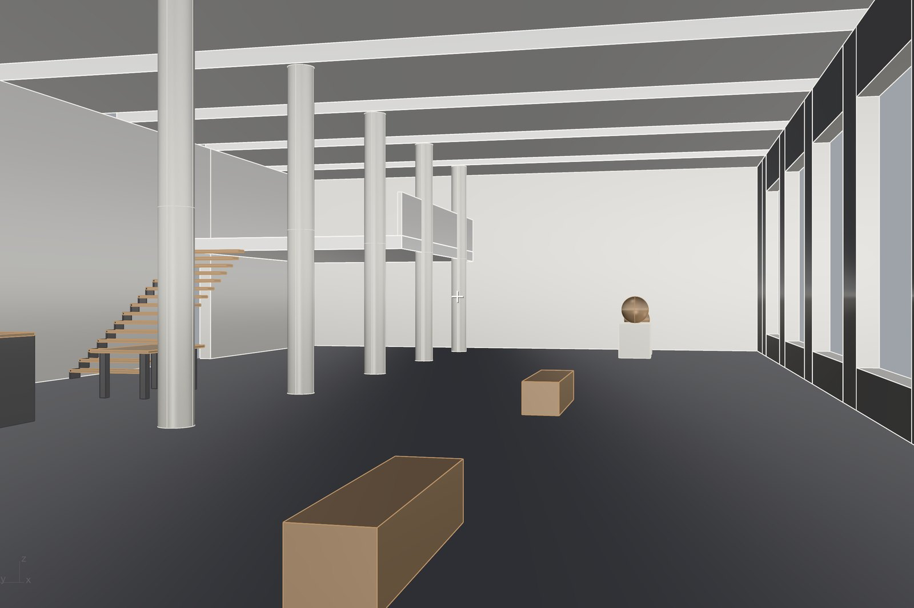

[English](README.md) · **한국어**

<p align="center"></p>

# Promenade

Promenade — macOS용 Rhinoceros® 9에서 쓰는 1인칭 걷기 탐색 플러그인입니다(Apple Silicon).
건축·실내·공간 디자이너가 사람 눈높이에서 공간을 걸어 보고, 구도를 잡고, 이미지와 뷰로 남기는 흐름에 맞췄습니다.
조작 방식은 게임식 1인칭 이동에서 착안했습니다. 무료 오픈 소스(MIT)입니다.



## 설치

Rhino를 종료한 뒤 설치합니다.

- **Package Manager**(공개 후): Rhino에서 `PackageManager`를 실행하고 "Promenade"를 검색해 설치합니다.
- **릴리스 `.yak` 파일**: [Releases](https://github.com/vynnlee/promenade/releases)에서
  `promenade-0.3.0-rh9_0-mac.yak`을 받아 설치합니다.
  ```sh
  "/Applications/Rhino 9.app/Contents/Resources/bin/yak" install promenade-0.3.0-rh9_0-mac.yak
  ```
- **직접 설치**: `.yak`은 zip 파일입니다. 폴더에 풀고 `Promenade.rhp`를 Rhino 창으로 끌어다 놓습니다.
  `JoltPhysicsSharp.dll`, `libjoltc.dylib`, `Promenade.rui`는 같은 폴더에 둡니다.

Yak으로 설치하면 `~/Library/Application Support/McNeel/Rhinoceros/packages/9.0/Promenade/`에 들어갑니다.
플러그인이 처음 로드될 때(예: `Walk`를 한 번 실행) Promenade 툴바(`Promenade.rui`)가 떠 있는 창으로 나타납니다.

## 빌드

.NET 10 SDK와 `/Applications/Rhino 9.app`의 Rhino 9이 필요합니다.

```sh
scripts/build.sh                       # → bin/Release/net10.0/Promenade.rhp
dotnet run --project tests             # 계산 로직 자가 점검 (Rhino 없이 실행)
python3 scripts/make-rui.py            # ui/icons/*.svg → ui/Promenade.rui (툴바)
scripts/install.sh --dry-run           # 빌드와 Yak 패키징만 하고 설치하지 않음
scripts/install.sh                     # dist/promenade-*-rh9_0-mac.yak을 만들고 Yak으로 설치 (Rhino 종료 후)
```

`dotnet`이 PATH에 없으면 `~/.dotnet/dotnet`을 씁니다. 아이콘 원본은 `ui/icons/`(라이트·다크 SVG, 36×36)이고,
툴바 GUID는 `scripts/make-rui.py`에 고정되어 있습니다. 바꾸지 마세요(Rhino가 GUID로 툴바를 기억합니다).

## 조작 (걷는 중)

### 이동

| 키 | 걷기(Walk) | 날기(Fly) |
|---|---|---|
| W A S D / 방향키 | 앞·왼쪽·뒤·오른쪽 이동 | 시선 방향으로 이동 |
| Q / E | 왼쪽·오른쪽으로 돌기 | 아래·위로 이동 |
| Space | 점프 (약 0.5 m) | — |
| 마우스 | 둘러보기 | 둘러보기 |
| 오른쪽 클릭 (둘러보기 모드) | 십자선이 가리키는 바닥으로 순간 이동. 벽을 누르면 그 벽 앞 바닥으로 | 맞은 곳 약 1 m 앞으로 |
| 왼쪽 클릭 (둘러보기 모드) | 커서 모드로 전환 (커서가 나타남) | 같음 |
| 오른쪽 클릭 (커서 모드) | 둘러보기로 복귀 | 같음 |
| 휠 | 걷는 속도 ×1.25 / ÷1.25 (0.2–30 m/s) | 같음 |
| Shift | 달리기 ×2 (기본 5 m/s) | 같음 |
| Tab | 날기로 전환 | 걷기로 전환 |
| Esc | 종료 | 종료 |

### 몸·측정

| 키 | 기능 |
|---|---|
| H | 눈높이 전환: 서기 1.6 m → 카메라 1.2 m → 휠체어 1.2 m → 어린이 1.0 m |
| M | 십자선이 가리키는 곳까지 거리 (걷기: 선 자리의 바닥–천장 높이도). 예: `4.27 m · ceiling 2.70 m` |

### 화면 구성

| 키 | 기능 |
|---|---|
| 1–5 | 렌즈 14 / 18 / 24 / 35 / 50 mm (35 mm 환산). 화면에 `24 mm · 74° H`처럼 수평 화각 표시 |
| - / = | 렌즈 ÷1.1 / ×1.1 (10–200 mm) |
| T | 2점 투시 켜기/끄기. 세로선이 수직으로 유지되고, 위아래를 보면 카메라가 기울지 않고 화면이 위아래로 이동(렌즈 시프트, 최대 ±60°) |
| V | 표시 모드 순환: Shaded → Rendered → Arctic → Technical → Pen (없는 모드는 건너뜀) |
| F | 촬영 프레임 비율 순환: 끔 → 16:9 → 3:2 → 4:5 → 1:1 → A(√2 가로) → 2.39:1 → 끔. 프레임 밖은 어둡게 표시. 예: `4:5 · 3072×3840` |
| G | 구도 가이드 켜기/끄기 (기본: 꺼짐): 3분할선, 가운데 표시(십자선이 없을 때), 눈높이 수평선(청록) |
| P | 스크린샷: `<문서 폴더>/<문서 이름> - Walk shots/`(저장 안 된 문서는 `~/Pictures/Promenade/`)에 PNG로 저장하고, 같은 이름의 명명된 뷰도 저장. 프레임이 켜져 있으면 프레임 안만 렌더 크기(예: 3840×2160)로, 꺼져 있으면 뷰포트 전체를 화면 해상도로 |

### 촬영

좋은 장면을 찾아 걷다가 세 단계로 남깁니다.

1. **비율 고르기**: F로 16:9, 3:2, 4:5(세로), 1:1, A(√2, 297:210 가로), 2.39:1 중에서 고릅니다. Rhino의 렌더 크기
   (`Render Settings`의 이미지 크기, 긴 변 기본 3840 px)와 Safe Frame의 Live Frame을 그대로 쓰므로 문서에 저장되고,
   Rhino의 렌더링도 같은 프레임으로 나옵니다. 걷는 동안 프레임 밖은 45 % 검정으로 덮입니다.
2. **구도 잡기**: G로 3분할선과 눈높이 수평선을 켭니다. 수평선은 눈높이의 수평면이 화면에 닿는 선이라, 위아래를 보거나
   2점 투시로 화면을 옮겨도 실제 눈높이를 가리킵니다. 가이드는 화면에만 보이고 이미지에는 찍히지 않습니다.
3. **찍기**: P를 누르면 프레임 안만 렌더 크기 그대로 PNG로 저장합니다. 예: `Saved Walk 2026-11-26 141502 · 3840×2160`

긴 변 크기는 `WalkFrame`의 `LongSide` 옵션으로 바꿉니다(예: 1920 / 3840 / 5760).

### 저장 뷰·일조

| 키 | 기능 |
|---|---|
| N | 현재 시점을 명명된 뷰 `Walk 01`, `Walk 02`, …로 저장 |
| , / . | 이전·다음 `Walk` 뷰로 순간 이동 |
| [ / ] | 태양 시각 −/+ 1시간 (Shift: 15분) |
| fn+F3 또는 ` | 디버그 정보 켜기/끄기 (기본: 꺼짐) |
| B | 블록 모드 켜기/끄기 (기본: 꺼짐, 아래 참고) |

- 둘러보기 모드에서는 화면 한가운데에 흰 십자선(+)이 보입니다. 오른쪽 클릭 순간 이동과 M 측정이 겨누는 곳이고,
  2점 투시에서 화면이 위아래로 이동해도 그대로 시선 방향을 가리킵니다. `WalkCrosshair`로 끕니다.
- 커서 모드에서는 커서가 보이고 마우스로 시점이 돌지 않아서 Rhino 메뉴·패널·툴바를 왼쪽 클릭으로 쓸 수 있습니다.
  왼쪽 클릭은 순간 이동에 쓰지 않으므로, 실수로 눌러도 위치가 바뀌지 않습니다.
  툴바 명령이 숫자나 옵션을 물으면 그동안은 걷기 단축키 대신 입력이 Rhino로 갑니다.
- 다른 앱으로 전환하면 걷기가 끝나고 커서가 돌아옵니다. 툴바의 Walk 버튼을 다시 눌러도 종료됩니다.
  걷는 동안 명령행에 `Walk`를 직접 치면 W·A가 이동 키로 먹히므로 툴바나 별칭을 쓰세요.
- 현재 상태는 명령 프롬프트에 표시됩니다. 예: `Walk | 2.5 m/s | Tab: fly, Space: jump, RMB: teleport, LMB: cursor, Esc: exit`
- 땅에서는 키를 누르면 즉시 그 속도로 움직이고 떼면 즉시 멈춥니다. 점프하거나 떨어지는 동안에는 땅을 떠날 때의
  속도를 그대로 유지합니다(공중 조작 없음). 날기 모드만 부드럽게 가속하고, 충돌 없이 벽을 통과합니다.
- 렌즈, 2점 투시, 눈높이, 십자선·디버그·구도 가이드 표시 설정은 다음 `Walk`에도 유지됩니다.

## 명령과 툴바

Promenade 툴바의 버튼 12개는 모두 아래 명령을 실행합니다(`WalkDebug`·`WalkCrosshair`는 툴바에 없고 명령으로만 씁니다).
걷지 않을 때도 활성 뷰에서 동작합니다(`WalkDebug`·`WalkCrosshair`·`WalkGuides`는 설정만 바꾸고, 표시는 걷는 동안에만 나옵니다).

| 명령 | 기능 |
|---|---|
| `Walk` | 걷기 시작·종료 |
| `WalkEyeHeight` | 눈높이 Standing / Camera / Wheelchair / Child (걷는 중이면 바로, 아니면 다음 걷기부터) |
| `WalkLens` | 렌즈 (숫자 입력 또는 Lens14–Lens50 옵션) |
| `WalkTwoPoint` | 2점 투시 켜기/끄기 |
| `WalkDisplayMode` | 표시 모드 순환 |
| `WalkFrame` | 촬영 프레임 비율: Off / R16x9 / R3x2 / R4x5 / R1x1 / A / R239, `LongSide`로 긴 변 픽셀 수(기본 3840). Enter는 지금 비율을 새 크기로 |
| `WalkGuides` | 구도 가이드 켜기/끄기 (기본: 꺼짐) |
| `WalkScreenshot` | 스크린샷 + 같은 이름의 명명된 뷰 (프레임이 켜져 있으면 프레임만 렌더 크기로) |
| `WalkSaveView` | 현재 뷰를 `Walk NN`으로 저장 |
| `WalkTour` | `Walk` 뷰를 번호 순서대로 걷는 속도(약 2.5 m/s)로 이어 보여 주고 뷰마다 1.5초 멈춤. Esc로 멈춤. 뷰가 2개 이상 필요 |
| `WalkSun` | 태양 시각을 시간 단위로 입력 (예: 15.5 = 15:30) |
| `WalkDebug` | 디버그 정보 켜기/끄기 (기본: 꺼짐) |
| `WalkCrosshair` | 십자선 켜기/끄기 (기본: 켜짐) |
| `WalkBlocks` | 블록 모드 켜기/끄기 (걷는 중이 아니면 설정만 바꾸고 다음 걷기부터) |

- 저장한 뷰는 Rhino의 Named Views 패널에 그대로 나타나므로 이름을 바꾸거나 지울 수 있습니다.
- 태양: 문서의 Sun 시각을 바꿉니다. 날짜와 위치는 그대로입니다. 태양이 꺼져 있으면 켜고, 수동 위치 지정은 해제합니다.
  그림자는 Rendered·Arctic처럼 그림자를 그리는 표시 모드에서 보입니다.
- 디버그 정보: 기본으로 꺼져 있고(fn+F3, 백틱 또는 `WalkDebug`로 켬), 걷기 뷰에만 나타납니다(걷지 않을 때는 아무것도 그리지 않음).
  화면 왼쪽 위에 틱 속도, 모드·몸, 눈 위치(XYZ, m), 발 높이, 방향(나침반)·피치, 속도, 바닥 상태,
  시선이 닿는 곳까지 거리와 경사, 렌즈·투시·표시 모드를, 오른쪽 위에 충돌 메시 삼각형 수·생성 시간·원점, 태양 시각,
  단위, 걷기 시간을 흰 글씨로 표시합니다. 십자선과 함께 스크린샷(P)에는 찍히지 않습니다. F3는 macOS 기본 설정에서 Mission
  Control이므로 fn+F3를 누르거나 백틱(`)을 씁니다.

## 블록 모드 (이스터에그)

걷는 중에 B(또는 `WalkBlocks`)를 누르면 1 m 돌 블록을 쌓고 부술 수 있습니다. 다시 B를 누르면 평소 조작으로 돌아옵니다.

| 조작 (둘러보기 모드) | 기능 |
|---|---|
| 오른쪽 클릭 | 십자선이 가리키는 면 바로 바깥 칸에 블록 놓기 (6 m 이내, 몸과 겹치는 칸은 거절) |
| 왼쪽 버튼 누르고 있기 | 가리키는 블록을 약 0.6초 동안 금이 가다가 부숨 (블록 모드로 놓은 블록만, 모델은 그대로) |
| Space | 점프가 약 1.2 m로 높아져 블록 하나 위로 올라설 수 있음 |

- 블록은 세계 좌표 1 m 격자에 맞춘 실제 상자(`Promenade Blocks` 레이어, 회색)라서 걷기를 끝내도 모델에 남고, 지우거나 Undo할 수 있습니다.
  다음 걷기에서는 이 레이어의 1 m 격자 정육면체를 다시 블록으로 알아보고, 올라서거나 부술 수 있습니다.
- Rendered 모드에서는 레이어 재질로 16×16 픽셀 돌 텍스처(`~/Library/Application Support/Promenade/stone16.png`, 처음 블록을 놓을 때 생성)가 보입니다. Shaded에서는 레이어 색(회색)입니다.
- 블록 모드에서는 오른쪽 클릭 순간 이동과 왼쪽 클릭 커서 모드 전환을 쓰지 않습니다. 커서 모드에서는 평소와 같습니다.
- 화면에는 가리키는 블록의 윤곽선, 오른쪽 아래의 블록형 팔(걸을 때 흔들리고, 놓거나 부술 때 휘두름), 아래쪽 가운데의 9칸 슬롯 바가 보입니다.
  모두 플러그인이 직접 그린 것이고 스크린샷(P)에는 찍히지 않습니다.

## 물리

걷기 모드의 충돌은 [Jolt Physics](https://github.com/jrouwe/JoltPhysics)의 `CharacterVirtual`이 처리합니다.

- 몸은 반지름 0.3 m 캡슐입니다. 키: 서기 1.75 m(눈 1.6 m), 카메라 1.75 m(눈 1.2 m — 서 있는 사람이 실내 사진 높이 1.0–1.4 m에서 찍는 경우라 몸은 그대로), 휠체어 1.35 m(눈 1.2 m), 어린이 1.15 m(눈 1.0 m).
  몸이 낮아지면 서서는 못 지나가는 낮은 보나 선반 밑도 지나갈 수 있습니다. 머리 위가 막혀 있으면 키를 키우지 않고
  "Not enough headroom"을 띄웁니다. 0.6 m보다 좁은 틈은 지나갈 수 없습니다.
- 계단과 턱은 0.4 m까지 그냥 오르고, 내려갈 때도 0.4 m까지는 바닥에 붙어 따라갑니다. 그보다 높으면 점프해야 합니다.
- 45°보다 가파른 경사는 오를 수 없고 미끄러져 내려옵니다.
- 벽에 부딪히면 벽을 따라 미끄러지고, 점프하다 천장에 머리가 닿으면 바로 떨어집니다.
- Rhino 렌더 설정의 Ground Plane이 켜져 있으면 그 높이를(자동이면 모델의 가장 낮은 점), 꺼져 있으면 z = 0을
  바닥으로 씁니다. 이 바닥 아래는 꽉 찬 공간이라 어떤 속도로 떨어져도 뚫고 내려가지 않습니다.
- 걷기 2.5 m/s, 달리기 5 m/s, 점프 초속 3.2 m/s, 중력 9.81 m/s². 문서 단위에 맞춰 환산합니다.

## 한계

- 충돌 형상은 `Walk`를 시작할 때 보이는 객체(잠긴 객체, 중첩 블록 포함)를 메시 하나로 합쳐 한 번만 만듭니다.
  걷는 도중 바꾼 형상은 다시 시작해야 반영됩니다. 메시가 크면 시작할 때 시간이 걸립니다.
- Ground Plane 아래(지하층 등)는 꽉 찬 공간이므로 걸어서 들어갈 수 없습니다. 날기 모드로는 들어갈 수 있지만
  걷기로 바꾸면 바닥 위로 밀려 올라옵니다.
- macOS용 Jolt는 단정밀도(float)입니다. 모델 중심을 원점으로 옮겨 계산하므로 보통 모델은 문제없지만, 중심에서
  수 km 이상 떨어지면 정밀도가 떨어집니다. 바닥 평면은 모델 중심에서 100 km까지만 있습니다.
- macOS(Apple Silicon) 전용입니다.

## 라이선스

Promenade는 MIT 라이선스입니다([LICENSE](LICENSE)). 만든 사람: Seongbeen Lee.
Jolt Physics와 JoltPhysicsSharp도 MIT 라이선스이며, 고지는 [THIRD-PARTY-NOTICES.md](THIRD-PARTY-NOTICES.md)에 있고 패키지에 함께 들어갑니다.
패키지에는 `JoltPhysicsSharp.dll`과 `libjoltc.dylib`(JoltPhysics.Native)이 포함됩니다.

버그 제보와 제안은 [GitHub Issues](https://github.com/vynnlee/promenade/issues)로 보내 주세요.

Rhinoceros is a registered trademark of Robert McNeel & Associates. Promenade is not affiliated with or endorsed by McNeel.
