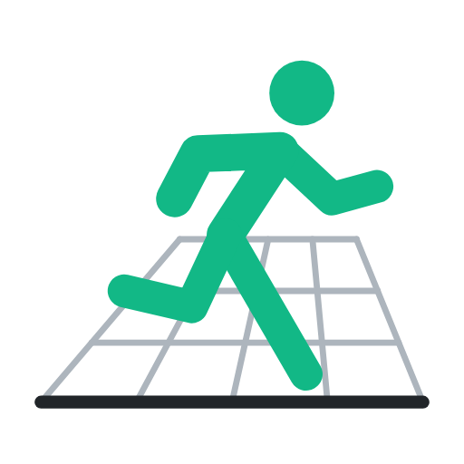
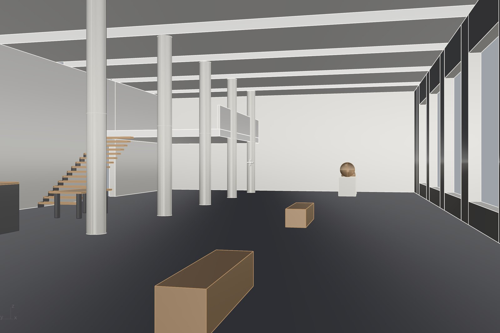

**English** · [한국어](README.ko.md)

<p align="center"></p>

# Promenade

Promenade: first-person walkthroughs for Rhinoceros® 8 and 9 on Mac and Windows.

Walk your model at human eye level, then compose and capture shots without leaving the viewport.
Made for architects, interior and spatial designers.



Free and open source (MIT).

## Features

**Walk & physics**
- WASD / arrow keys and mouse look, with collision, stairs, slopes and gravity.
- Run, jump, adjust speed with the scroll wheel (0.2–30 m/s), or switch to fly mode and pass through walls.
- Right-click to teleport to the floor under the crosshair.

**Body & accessibility checks**
- Eye-height presets: Standing 1.6 m, Camera 1.2 m, Wheelchair 1.2 m, Child 1.0 m. The collision body
  shrinks with them, so you can test what a wheelchair user or a child can pass under.
- Measure the distance to any point, plus floor-to-ceiling height where you stand.

**Framing & capture**
- Lens presets 14 / 18 / 24 / 35 / 50 mm (35 mm equivalent) and free zoom from 10 to 200 mm.
- Two-point perspective: verticals stay vertical; looking up or down shifts the image instead of tilting the camera.
- Shot frames 16:9, 3:2, 4:5, 1:1, A (√2 landscape) and 2.39:1, using Rhino's render size and Safe Frame.
- Composition guides: rule of thirds, centre mark, eye-level horizon.
- Screenshots save the framed area at render size (e.g. 3840×2160) as a PNG plus a matching named view.

**Views, tour & sun**
- Save the current position as a named view (`Walk 01`, `Walk 02`, …) and step through them.
- Play the saved views back as a walking-pace tour.
- Change the sun time by the hour or 15 minutes to check daylight and shadows.
- Cycle display modes: Shaded, Rendered, Arctic, Technical, Pen.

**Toolbar**
- A "Promenade" toolbar with 12 buttons appears when the plug-in first loads. Every button runs a command
  and works outside walk mode on the active view.

**Debug HUD**
- Optional on-screen readout: frame rate, position, heading, speed, ground state, hit distance and slope,
  collision mesh stats, sun time. Never appears in screenshots.

**Block mode** (easter egg): press B while walking to place and break 1 m stone blocks.

## Requirements

- Rhinoceros 8 (8.21 or later, on its default .NET 8 runtime) or Rhinoceros 9
- Mac (Apple Silicon or Intel) or Windows (x64)

## Install

Quit Rhino first.

- **Package Manager** (once published): in Rhino, run `PackageManager`, search for "Promenade", install.
- **From a release `.yak`** (Mac): download `promenade-0.4.0-rh8_21-mac.yak` from
  [Releases](https://github.com/vynnlee/promenade/releases), then:
  ```sh
  "/Applications/Rhino 9.app/Contents/Resources/bin/yak" install promenade-0.4.0-rh8_21-mac.yak
  ```
- **Manual**: a `.yak` is a zip archive. Unzip it into a folder and drag `Promenade.rhp` onto the Rhino window.
  Keep `JoltPhysicsSharp.dll`, `libjoltc.dylib` (Mac) or `joltc.dll` (Windows) and `Promenade.rui` next to it.

The toolbar (`Promenade.rui`) loads automatically with the plug-in.

## Quick start

1. Open a perspective view and run `Walk` (or click the Walk button).
2. Move with WASD and look with the mouse. Press Tab to fly, Esc to exit.
3. Press F to pick a frame, G for guides, then P to save a shot.

## Controls

While walking:

| Key | Action |
|---|---|
| W A S D / arrows | Move (fly: move along the view direction) |
| Q / E | Turn left / right (fly: down / up) |
| Mouse | Look around |
| Space | Jump (about 0.5 m) |
| Shift | Run ×2 |
| Scroll wheel | Walking speed ×1.25 / ÷1.25 (0.2–30 m/s) |
| Tab | Toggle walk / fly |
| Right-click | Teleport to the floor under the crosshair (a wall: the floor in front of it; fly: ~1 m short of the hit). In cursor mode: back to mouse look |
| Left-click | Cursor mode: show the cursor to use Rhino menus, panels and toolbars |
| H | Eye height: Standing 1.6 m → Camera 1.2 m → Wheelchair 1.2 m → Child 1.0 m |
| M | Measure to the crosshair (walk mode also shows floor-to-ceiling height), e.g. `4.27 m · ceiling 2.70 m` |
| 1–5 | Lens 14 / 18 / 24 / 35 / 50 mm |
| - / = | Lens ÷1.1 / ×1.1 (10–200 mm) |
| T | Two-point perspective on/off (shift up to ±60°) |
| V | Cycle display modes (missing modes are skipped) |
| F | Cycle frame: off → 16:9 → 3:2 → 4:5 → 1:1 → A → 2.39:1 → off |
| G | Composition guides on/off |
| P | Screenshot + named view |
| N | Save view as `Walk NN` |
| , / . | Previous / next `Walk` view |
| [ / ] | Sun time −/+ 1 hour (with Shift: 15 minutes) |
| ` or fn+F3 | Debug HUD on/off |
| B | Block mode on/off |
| Esc | Exit |

Notes:
- Switching to another app ends the walk. Clicking the Walk toolbar button again also ends it.
- While walking, don't type `Walk` on the command line: W and A are movement keys. Use the toolbar or an alias.
- When a toolbar command asks for a number or option, input goes to Rhino until it finishes.
- On the ground, movement starts and stops instantly. In the air you keep the speed you had at take-off.
  Fly mode accelerates smoothly and has no collision.
- Lens, two-point, eye height, crosshair, HUD and guide settings carry over to the next `Walk`.
- F3 is Mission Control in the default macOS settings, so use fn+F3 or the backtick key.

## Commands

| Command | What it does |
|---|---|
| `Walk` | Start or stop walking |
| `WalkEyeHeight` | Eye height: Standing / Camera / Wheelchair / Child |
| `WalkLens` | Set the lens (a number or `Lens14`–`Lens50`) |
| `WalkTwoPoint` | Two-point perspective on/off |
| `WalkDisplayMode` | Cycle display modes |
| `WalkFrame` | Frame aspect: Off / R16x9 / R3x2 / R4x5 / R1x1 / A / R239; `LongSide` sets the long edge in pixels (default 3840) |
| `WalkGuides` | Composition guides on/off (default off) |
| `WalkScreenshot` | Screenshot + matching named view |
| `WalkSaveView` | Save the current view as `Walk NN` |
| `WalkTour` | Tour the `Walk` views in order at about 2.5 m/s, pausing 1.5 s at each (needs 2+ views; Esc stops) |
| `WalkSun` | Set the sun time in hours (e.g. 15.5 = 15:30) |
| `WalkDebug` | Debug HUD on/off (default off) |
| `WalkCrosshair` | Crosshair on/off (default on) |
| `WalkBlocks` | Block mode on/off |

Screenshots go to `<document folder>/<document name> - Walk shots/`, or `~/Pictures/Promenade/` for an unsaved
document. With a frame on, only the framed area is rendered at render size; otherwise the whole viewport at
screen resolution.

`WalkSun` changes only the document's sun time; date and location stay. It turns the sun on if needed and
clears manual positioning. Shadows show in display modes that draw them (e.g. Rendered, Arctic).

Block mode places real 1 m boxes on the `Promenade Blocks` layer. They stay in the model and can be deleted or
undone. Its stone texture is stored in `~/Library/Application Support/Promenade`.

## How it works

Walk-mode collision uses [Jolt Physics](https://github.com/jrouwe/JoltPhysics) `CharacterVirtual`:

- The body is a capsule with a 0.3 m radius. Heights: Standing 1.75 m, Camera 1.75 m, Wheelchair 1.35 m, Child 1.15 m.
  Gaps narrower than 0.6 m are blocked. If there's no headroom to stand back up, it shows "Not enough headroom".
- Steps and kerbs up to 0.4 m are climbed automatically, and the body sticks to the floor going down up to 0.4 m.
- Slopes steeper than 45° can't be climbed; you slide down.
- Walls are slid along; hitting a ceiling mid-jump drops you straight down.
- The floor is Rhino's Ground Plane height when it is on (the model's lowest point if set to automatic), otherwise z = 0.
  Everything below it is solid, so you can't fall through at any speed.
- Walk 2.5 m/s, run 5 m/s, jump 3.2 m/s take-off, gravity 9.81 m/s², converted to document units.

## Limitations

- The collision mesh is built once when `Walk` starts, from visible objects (locked objects and nested blocks
  included). Geometry edited during the walk needs a restart. Large meshes take time to build.
- The space below the Ground Plane is solid: you can't walk into basements under it. Fly mode can go there,
  but switching to walk pushes you back up.
- Jolt on macOS is single precision. Coordinates are recentred on the model, but precision drops several km
  from its centre. The ground plane extends 100 km from the model centre.
- Windows support is new and has not been tested on a Windows PC yet. Please report problems on GitHub Issues.

## Building from source

Requires the .NET SDK (8 or later) and Rhino 9 installed in `/Applications/Rhino 9.app`.

```sh
scripts/build.sh                 # build Promenade.rhp into bin/Release/net8.0/
dotnet run --project tests       # self-check of the math, runs without Rhino
python3 scripts/make-rui.py      # ui/icons/*.svg → ui/Promenade.rui (toolbar)
scripts/install.sh --dry-run     # build and package dist/*.yak only
scripts/install.sh               # build, package and install with Rhino's Yak (quit Rhino first)
```

If `dotnet` isn't on your PATH, the scripts use `~/.dotnet/dotnet`. Toolbar GUIDs are fixed in
`scripts/make-rui.py`; don't change them (Rhino remembers toolbars by GUID).

## Contributing

Bug reports and pull requests are welcome on [GitHub Issues](https://github.com/vynnlee/promenade/issues).
Please include your Rhino build and your macOS or Windows version. Run `dotnet run --project tests` before sending a change.

## License

MIT, see [LICENSE](LICENSE). Third-party licenses are in [THIRD-PARTY-NOTICES.md](THIRD-PARTY-NOTICES.md)
and ship inside the package.

Rhinoceros is a registered trademark of Robert McNeel & Associates. Promenade is not affiliated with or endorsed by McNeel.

## Credits

- [Jolt Physics](https://github.com/jrouwe/JoltPhysics) by Jorrit Rouwe (MIT)
- [JoltPhysicsSharp](https://github.com/amerkoleci/JoltPhysicsSharp) and joltc by Amer Koleci (MIT)
- Interaction design inspired by game-style first-person navigation.

Made by Seongbeen Lee.
